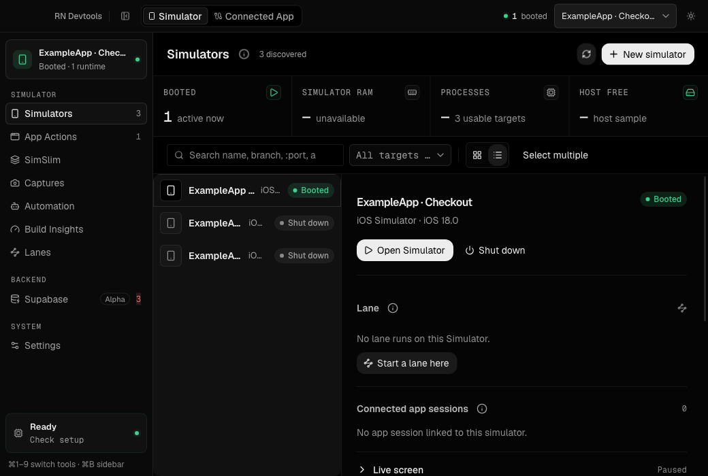
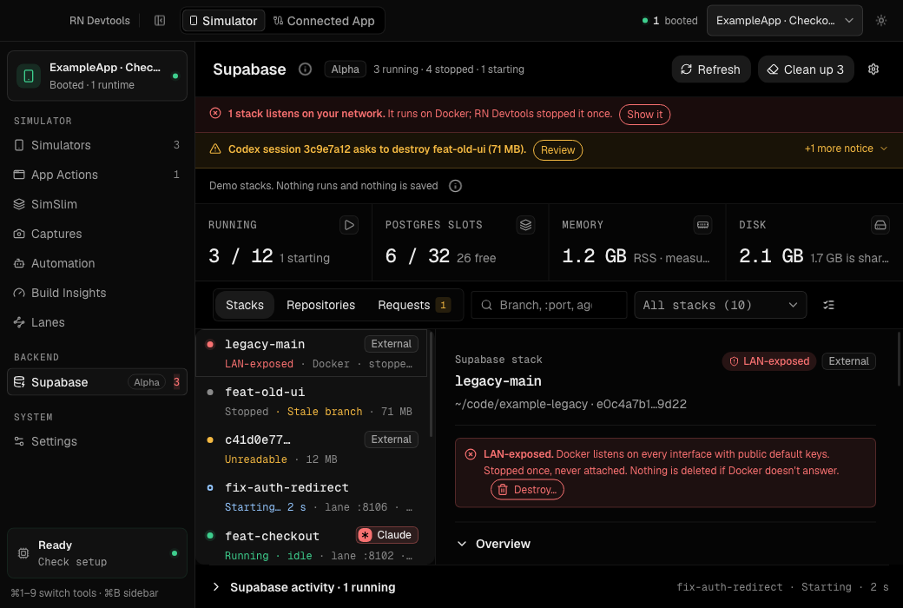
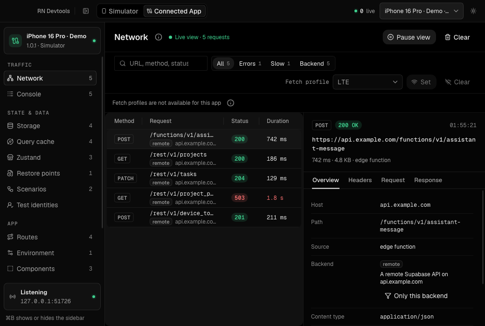

# RN Devtools

A desktop workspace for React Native diagnostics, iOS Simulator fleets, and parallel development with isolated local backends.

[Features](#features) · [Install](#install) · [Try the demo](#try-the-demo) · [Development](#development)



## Features

- **Parallel Simulator lanes.** Run each git worktree on its own Simulator and Metro port. Reuse native builds when fingerprints match, and keep branch ownership visible.
- **Local Supabase per worktree.** Manage native Postgres, REST, Auth, Storage, Realtime, and Functions on loopback. Inspect services and logs, apply migrations, and connect each lane to its own backend. This integration is alpha; per-stack signing keys are opt-in.
- **Connected app diagnostics.** Inspect network requests, console output, storage, React Query, Zustand, navigation, performance, environment, and components. Add host adapters and plugins for your app.
- **Simulator controls and automation.** Launch apps, open deep links, manage permissions, capture screenshots and recordings, run recipes, and expose the same workflows to coding agents through the CLI and MCP.
- **Experimental SimSlim profiles.** Reduce background Simulator services with compatibility checks, verification, checkpoints, and undo.





*Screenshots show the application with synthetic demo data.*

## Install

Download the signed and notarized [RN Devtools 0.2.0 preview for Apple silicon](https://github.com/adalloul0928/rndevtools/releases/download/desktop-v0.2.0/RN-Devtools-0.2.0-arm64.dmg). Open the DMG, drag **RN Devtools** into **Applications**, and launch it. The [release page](https://github.com/adalloul0928/rndevtools/releases/tag/desktop-v0.2.0) includes checksums and preview notes.

The declared minimum is macOS 14. This preview has been tested on one Apple silicon Mac with macOS 27 and Xcode 27; a separate clean-Mac installation and broader version coverage are still pending.

React Native npm packages remain unpublished. Homebrew installation is not available yet. Use the repository's Expo example below to try connected-app diagnostics.

### Requirements

| Feature | Requires |
| --- | --- |
| Desktop app | Apple silicon Mac, macOS 14 or later |
| Simulator management | Xcode with an installed iOS Simulator runtime |
| Worktree lanes | Git, Node.js, project dependencies, and a compatible Expo development build installed on each Simulator |
| Local Supabase | The project's own Supabase CLI; the verified example pins 2.121.0 and uses the native runtime |
| On-device panels | Compatible React Native/Expo dependencies; see the [core package](packages/core/README.md) |

The prebuilt app includes its native helpers. Node.js, pnpm, Go, and a HeroUI Pro license are not needed merely to install the desktop app; source builds and your app's development workflow have their own requirements.

## Try the demo

The [Expo example](examples/expo-demo/README.md) includes the development client, diagnostic plugins, desktop connection, native build cache, and a local Supabase project.

```sh
git clone https://github.com/adalloul0928/rndevtools.git
cd rndevtools
pnpm install
pnpm --dir examples/expo-demo exec expo run:ios
```

Open RN Devtools alongside the demo to inspect its connection. Building the desktop app from source is described below.

For your own app, start with the example's host adapter and [production pruning setup](packages/react-native/README.md). Keep diagnostics behind a development-only import seam, use `withDevtoolsPruning`, and verify a production export with `rndevtools-verify-bundle`.

## Development

Use Node.js 24, pnpm 12.4.1, Go 1.27, and Xcode's Swift toolchain. The desktop UI requires a [HeroUI Pro](https://www.heroui.pro/) license and `HEROUI_AUTH_TOKEN`; the React Native packages do not.

```sh
pnpm install
pnpm --filter @rndevtools/desktop native:build
pnpm --filter @rndevtools/desktop dev
```

Privileged native Simulator mutations require a signed packaged app. Set `APPLE_TEAM_ID` in the build environment and follow the [release guide](docs/RELEASING.md). Unsigned development builds can still inspect devices.

```sh
pnpm check:public
pnpm quality
pnpm --filter @rndevtools/desktop quality
pnpm --filter @rndevtools/desktop test:e2e
pnpm --dir examples/expo-demo verify:bundle
```

| Workspace | Purpose |
| --- | --- |
| [`packages/core`](packages/core) | On-device panel runtime and diagnostic plugins |
| [`packages/react-native`](packages/react-native) | Desktop client, authorization, adapters, build cache, and production pruning |
| [`apps/desktop`](apps/desktop) | Electron inspector, Simulator management, CLI, and native helpers |

Both React Native packages ship TypeScript source so the consuming app's Babel pipeline can compile Reanimated worklets.

## License and credits

[MIT](LICENSE). The Simulator helper includes [SimSlim](https://github.com/MobAI-App/simslim), also MIT. See [third-party notices](apps/desktop/THIRD_PARTY_NOTICES.md) and the helper's [provenance](apps/desktop/native/rndevtools-sim-helper/PROVENANCE.md).
